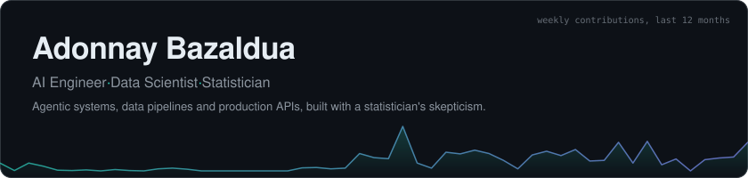
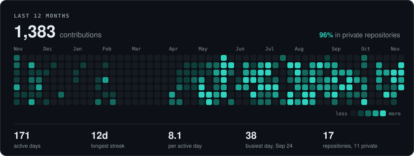
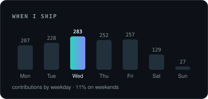

 

## Hi, I'm Adonnay

I'm a statistician who ended up shipping software. I build multi-agent systems, data pipelines and the APIs that put them in front of real users, and I like my models the way I like my code: tested, measurable and boring to operate.

- **Agents and LLMs**: orchestration, RAG, text-to-SQL, voice agents
- **Data**: ETL at the millions-of-rows scale, analytical modeling, classical statistics when it beats the neural net
- **Product**: FastAPI and Next.js services, Postgres, Docker, deployed and maintained

## A year on GitHub

Most of what I build is client and product work in private repositories, so stars won't tell you much. Activity does.

## Stack

 

 

## Selected work

| Project | What it is | Code |
| --- | --- | --- |
| **ZeroVox** | AI voice platform: Next.js and FastAPI, RAG on pgvector, telephony, appointment scheduling and automated agent provisioning. | Private |
| **Kisabella Financial Product Release** | Multi-agent financial evaluation: parallel specialist agents, orchestration and deterministic scoring behind a Next.js/FastAPI product. | Private |
| **Kisabella Liquor Distribution Analytics** | Streaming Bronze-Silver-Gold pipeline over 1.7 GB and 12.8 million sales records with Polars, DuckDB and an auditable Streamlit dashboard. | [Repo](https://github.com/AdonnayBazaldua/Kisabella-s-liquor-distribution) |
| **Crime Analysis in Mexico City** | Deep learning on about 2.1 million investigation records: classification, temporal prediction, spatial analysis and anomaly detection. | [Repo](https://github.com/AdonnayBazaldua/Crime-Analysis-in-Mexico-City-using-Neural-Networks) |
| **Stateless FastAPI Memory Assistant** | Session-isolated conversational REST API with FastAPI, LangChain and LangGraph, explicit schemas and tested endpoints. | [Repo](https://github.com/AdonnayBazaldua/Assistant-con-Memoria-en-FastAPI) |

Happy to walk through the private ones on a call.

---

Cards are generated from the GitHub API by <a href="./scripts/cards.py">a small script</a> in this repo. No third-party widgets.

