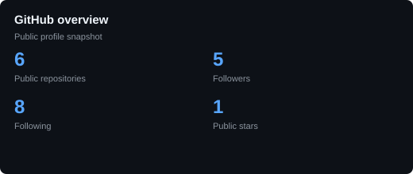
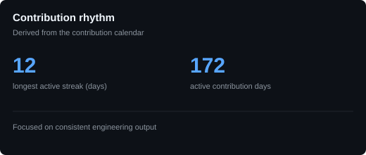
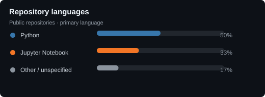
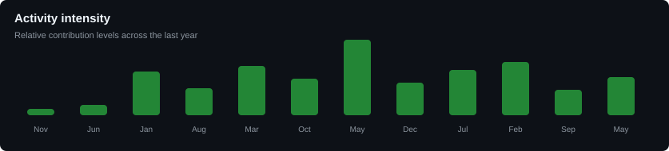

# Adonnay Bazaldua

### AI Engineer · Data Scientist · Statistician

Designing data products, agentic systems and production-ready APIs.

[LinkedIn](https://www.linkedin.com/in/adonnay-bazal%C3%BAa-62443b29a/) · [Email](mailto:david.jimenez@getzerovox.com)

---

## Profile

I build practical systems at the intersection of artificial intelligence, data engineering and statistical analysis. My work focuses on turning complex data and business requirements into reliable products with clear architecture, measurable outputs and maintainable interfaces.

Current areas of focus:

- Multi-agent systems and LLM orchestration
- Data-intensive ETL pipelines and analytical modeling
- REST APIs, asynchronous services and stateless application design
- Production-oriented engineering with Docker, PostgreSQL and cloud deployment

## Technical toolkit

| Area | Technologies |
| --- | --- |
| Languages | Python, TypeScript, R, SQL, Bash |
| AI and ML | LangGraph, LangChain, TensorFlow, neural networks, RAG, text-to-SQL |
| Data engineering | Polars, DuckDB, Apache Spark, PostgreSQL, Star Schema, Medallion Architecture |
| Backend and infrastructure | FastAPI, Docker, Linux, Git, REST, asynchronous services |
| Frontend and delivery | Next.js, Tailwind CSS, Streamlit, Railway, Vercel |

## Selected work

### [Kisabella Financial Product Release](https://github.com/AdonnayBazaldua/KISABELLA-Financial-product-release-approach)

Multi-agent system for evaluating whether a physical product is financially viable before launch. Four specialist agents analyze financials, market conditions, risk and strategy in parallel; an orchestrator reconciles the results into a structured verdict. Built with FastAPI, LangGraph, Claude, Next.js, PostgreSQL and Docker.

### [ZeroVox](https://github.com/AdonnayBazaldua/ZeroVox)

Production-oriented AI voice platform for business call handling, appointment scheduling and knowledge-base retrieval. The system combines a Next.js platform, FastAPI engine, RAG with pgvector, telephony integrations, billing and automated agent provisioning.

### [Kisabella Liquor Distribution Analytics](https://github.com/AdonnayBazaldua/Kisabella-s-liquor-distribution)

End-to-end analytics pipeline for 1.7 GB of transactional data and 12.8 million sales records. Uses a streaming Bronze–Silver–Gold architecture with Polars and DuckDB to produce an auditable star schema and a Streamlit dashboard.

### [Stateless FastAPI Memory Assistant](https://github.com/AdonnayBazaldua/Assistant-con-Memoria-en-FastAPI)

Session-isolated conversational API built with FastAPI, LangChain and LangGraph. Includes explicit request and response schemas, independent conversation histories and tested REST endpoints.

### [Crime Analysis in Mexico City](https://github.com/AdonnayBazaldua/Crime-Analysis-in-Mexico-City-using-Neural-Networks)

Deep learning study using approximately 2.1 million investigation records from Mexico City to explore classification, temporal prediction, spatial patterns and anomaly detection.

## GitHub snapshot

## Engineering signals

 

[View the current contribution calendar on GitHub](https://github.com/AdonnayBazaldua)

---

Open to conversations about AI engineering, data platforms and applied machine learning.

