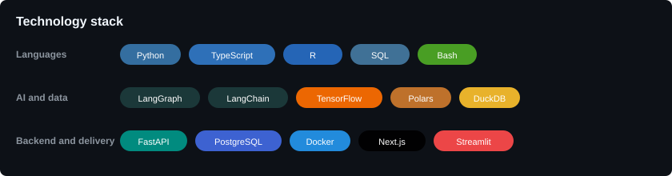

# Adonnay Bazaldua

### AI Engineer · Data Scientist · Statistician

Designing data products, agentic systems and production-ready APIs.

[LinkedIn](https://www.linkedin.com/in/adonnay-bazal%C3%BAa-62443b29a/) · [Email](mailto:david.jimenez@getzerovox.com)

---

## Profile

I build practical systems at the intersection of artificial intelligence, data engineering and statistical analysis. My work focuses on turning complex data and business requirements into reliable products with clear architecture, measurable outputs and maintainable interfaces.

Current areas of focus:

- Multi-agent systems and LLM orchestration
- Data-intensive ETL pipelines and analytical modeling
- REST APIs, asynchronous services and stateless application design
- Production-oriented engineering with Docker, PostgreSQL and cloud deployment

## Tech Stack

The broader toolkit includes RAG, text-to-SQL, PostgreSQL, Apache Spark, DuckDB, Railway, Vercel, Tailwind CSS, REST APIs and asynchronous services.

## Selected Projects

| Project | What it demonstrates |
| --- | --- |
| [Kisabella Financial Product Release](https://github.com/AdonnayBazaldua/KISABELLA-Financial-product-release-approach) | Multi-agent financial evaluation system with parallel specialist agents, orchestration, deterministic financial scoring and a Next.js/FastAPI product interface. |
| [ZeroVox](https://github.com/AdonnayBazaldua/ZeroVox) | Production-oriented AI voice platform combining Next.js, FastAPI, RAG with pgvector, telephony integrations, appointment scheduling and automated agent provisioning. |
| [Kisabella Liquor Distribution Analytics](https://github.com/AdonnayBazaldua/Kisabella-s-liquor-distribution) | Streaming Bronze-Silver-Gold pipeline processing 1.7 GB and 12.8 million sales records with Polars, DuckDB and an auditable Streamlit dashboard. |
| [Stateless FastAPI Memory Assistant](https://github.com/AdonnayBazaldua/Assistant-con-Memoria-en-FastAPI) | Session-isolated conversational REST API built with FastAPI, LangChain and LangGraph, with explicit schemas and tested endpoints. |
| [Crime Analysis in Mexico City](https://github.com/AdonnayBazaldua/Crime-Analysis-in-Mexico-City-using-Neural-Networks) | Deep learning study using approximately 2.1 million investigation records for classification, temporal prediction, spatial analysis and anomaly detection. |

## GitHub Stats

## Engineering signals

 

[View the current contribution calendar on GitHub](https://github.com/AdonnayBazaldua)

---

Open to conversations about AI engineering, data platforms and applied machine learning.

